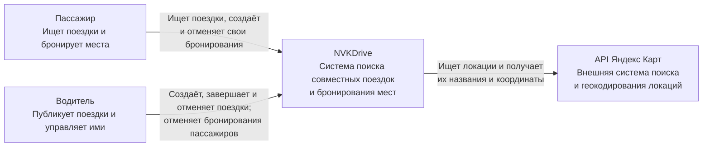
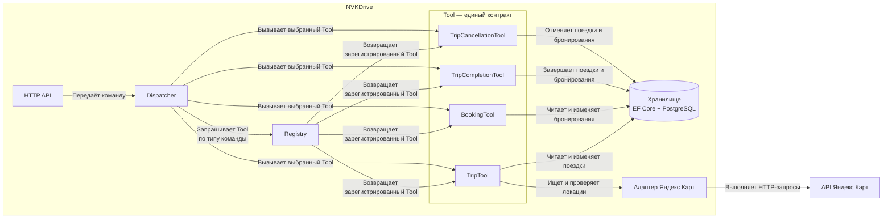
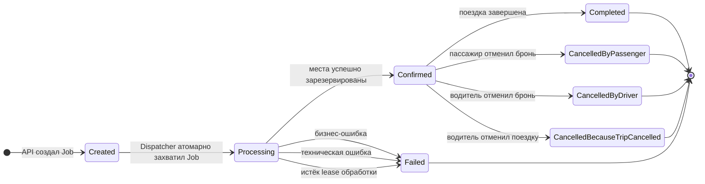

## Контекст системы

Контекстная схема показывает NVKDrive как единую систему, её пользователей и внешнюю систему, с которой она взаимодействует.



**Смысл стрелок:** стрелки показывают вызовы во время работы системы. Пользователи обращаются к NVKDrive через пользовательский интерфейс, а NVKDrive вызывает API Яндекс Карт. Стрелки не обозначают зависимости исходного кода.

> **Примечание:** «Пассажир» и «Водитель» — роли одного типа пользователя «Студент». Один пользователь может выступать пассажиром в одних поездках и водителем в других.


## Диаграмма компонентов



**Смысл стрелок:** стрелки показывают вызовы и передачу данных во время работы системы, а не зависимости исходного кода. HTTP API передаёт команду Dispatcher, Dispatcher получает из Registry подходящий Tool и вызывает его через единый контракт.

## Ответственность компонентов

| Компонент | Ответственность и скрываемые детали |
| --- | --- |
| `HTTP API` | Принимает запросы и формирует ответы; скрывает от внутренних компонентов HTTP-маршруты, заголовки и коды ответов. |
| `Dispatcher` | Получает команду и вызывает подходящий Tool; скрывает от входного слоя порядок выбора и запуска обработчика. |
| `Registry` | Сопоставляет тип команды с Tool; скрывает конкретные классы и способ создания обработчиков. |
| `TripTool` | Создаёт и ищет поездки; скрывает правила проверки поездок и локаций. |
| `BookingTool` | Создаёт и отменяет отдельные бронирования; скрывает атомарное резервирование и освобождение мест. |
| `TripCompletionTool` | Завершает поездки и активные бронирования; скрывает правила штатного завершения. |
| `TripCancellationTool` | Отменяет поездки и связанные бронирования; скрывает каскадное изменение состояний. |
| `Хранилище` | Хранит и атомарно изменяет данные; скрывает EF Core, транзакции и структуру PostgreSQL. |
| `Адаптер Яндекс Карт` | Ищет и геокодирует локации; скрывает протокол внешнего API, timeout, повторы и проверку ответа. |


## Диаграмма состояний BookingJob

`BookingJob` представляет обработку одного запроса на бронирование и дальнейший жизненный цикл созданной брони.



### Состояния

| Состояние | Описание |
| --- | --- |
| `Created` | Запрос принят, а Job сохранён, но Tool ещё не начал обработку. |
| `Processing` | Job атомарно захвачен одним Dispatcher и обрабатывается одним Tool. |
| `Confirmed` | Места успешно зарезервированы, связанная бронь активна. |
| `Failed` | Бронирование не выполнено из-за бизнес-ошибки, технической ошибки или прерванной обработки. |
| `Completed` | Поездка завершена, жизненный цикл брони закончен. |
| `CancelledByPassenger` | Пассажир отменил собственную бронь. |
| `CancelledByDriver` | Водитель отменил бронь пассажира. |
| `CancelledBecauseTripCancelled` | Бронь отменена вследствие отмены всей поездки. |

Состояния `Failed`, `Completed`, `CancelledByPassenger`, `CancelledByDriver` и `CancelledBecauseTripCancelled` являются конечными.

### Правила обработки

Переход `Created → Processing` выполняется атомарно в хранилище. При захвате Job система сохраняет:

- `workerId` — идентификатор обработчика;
- `leaseToken` — уникальный токен попытки обработки;
- `leaseExpiresAt` — срок действия захвата.

Завершить обработку переходом из `Processing` в `Confirmed` или `Failed` может только обработчик с актуальным `leaseToken`. Второй обработчик не может одновременно захватить тот же Job.

Создание брони, уменьшение числа свободных мест и переход `Processing → Confirmed` выполняются в одной транзакции PostgreSQL. Поэтому при прерывании сервера изменения либо сохраняются целиком, либо полностью откатываются.

Если сервер прервался до завершения транзакции:

1. изменения бронирования откатываются;
2. Job временно остаётся в состоянии `Processing`;
3. после истечения `leaseExpiresAt` Job переводится в `Failed`;
4. в Job сохраняется ошибка `PROCESSING_INTERRUPTED`;
5. система не запускает Job повторно автоматически.

Проверка истёкшего `lease` может выполняться при следующем чтении Job или при обращении к нему. Отдельный поток повторной обработки не требуется.

### Идемпотентное создание Job

Клиент передаёт `Idempotency-Key` при создании бронирования. На сочетание `userId + Idempotency-Key` устанавливается уникальное ограничение в базе данных.

- новый ключ создаёт новый `BookingJob`;
- повтор того же ключа с тем же телом возвращает ранее созданный Job;
- повтор не переводит Job обратно в `Processing` и не запускает Tool;
- тот же ключ с другим телом возвращает `409 IDEMPOTENCY_KEY_REUSED`;
- для повторной попытки после `Failed` пользователь отправляет новую команду с новым ключом, и система создаёт новый Job.

## Запрещённые переходы

Любой переход, отсутствующий на диаграмме, запрещён.

| Попытка перехода или операции | Ответ системы |
| --- | --- |
| `Created → Confirmed` | `409 INVALID_JOB_TRANSITION`: Job не может стать подтверждённым до начала обработки. |
| `Created → Completed` | `409 INVALID_JOB_TRANSITION`: Job не может завершиться до обработки и подтверждения. |
| Повторный захват `Processing` при действующем `lease` | `409 JOB_ALREADY_PROCESSING`: Job уже обрабатывается другим Tool. |
| `Processing → Confirmed` с недействительным или просроченным `leaseToken` | `409 JOB_LEASE_EXPIRED`: результат устаревшего обработчика отклонён. |
| `Failed → Processing` | `409 JOB_ALREADY_TERMINAL`: ошибочный Job нельзя запустить повторно. Нужна новая команда пользователя. |
| `Failed → Confirmed` | `409 JOB_ALREADY_TERMINAL`: Job уже завершён ошибкой и не может получить второй итог. |
| `Completed → Processing` | `409 JOB_ALREADY_TERMINAL`: завершённый Job нельзя запустить повторно. |
| `Completed → Confirmed` | `409 JOB_ALREADY_TERMINAL`: завершённый Job нельзя вернуть в активное состояние. |
| Любое состояние отмены → `Processing` | `409 JOB_ALREADY_TERMINAL`: отменённый Job нельзя запустить повторно. |
| Любое состояние отмены → `Confirmed` | `409 JOB_ALREADY_TERMINAL`: отменённая бронь не может стать подтверждённой без новой команды пользователя. |
| Повторный запрос с тем же ключом и другим телом | `409 IDEMPOTENCY_KEY_REUSED`: ключ идемпотентности уже связан с другим запросом. |

Пример единого тела ошибки:

```json
{
  "code": "INVALID_JOB_TRANSITION",
  "message": "Transition from 'Failed' to 'Confirmed' is not allowed",
  "field": "status"
}
```

### Проверка опасных сценариев

| Сценарий | Защита |
| --- | --- |
| Два Tool одновременно обрабатывают один Job | Атомарный переход `Created → Processing`; результат принимается только с актуальным `leaseToken`. |
| Сервер перезапустился, а Job остался в работе | После истечения `lease` Job переводится в `Failed` с кодом `PROCESSING_INTERRUPTED`. |
| Отменённый Job позднее стал подтверждённым | Состояния отмены конечные; запоздалый результат Tool отклоняется. |
| Job сначала завершился ошибкой, затем успешно | `Failed` является конечным состоянием; новая попытка создаёт новый Job. |
| Job стал успешным без обработки | `Confirmed` достижим только из `Processing`. |
| Успешный Job повторно запустили | `Completed` является конечным состоянием, а повтор запроса с тем же ключом возвращает сохранённый результат. |
